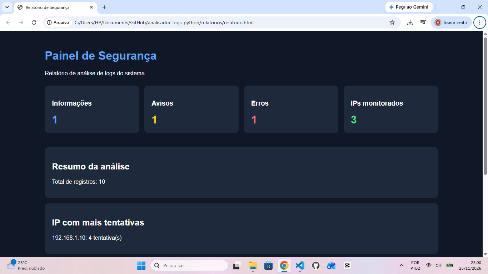

# Analisador de Logs com Python

Projeto desenvolvido para praticar programação Python e fundamentos de segurança da informação.

O **Analisador de Logs** lê um arquivo de registros do sistema, identifica eventos, contabiliza tentativas de acesso por endereço IP e gera relatórios em formato TXT e HTML.

## Funcionalidades

- Leitura automatizada de arquivos de log.
- Contagem de eventos INFO, WARNING e ERROR.
- Identificação e contabilização de tentativas de acesso por IP.
- Ordenação dos IPs pelo número de tentativas.
- Identificação do endereço IP com maior quantidade de acessos.
- Geração de alertas com base em um limite configurado.
- Criação de relatório TXT.
- Criação de painel HTML com indicadores visuais.

## Tecnologias utilizadas

- Python 3
- HTML5
- CSS3
- Visual Studio Code
- Git e GitHub

## Estrutura do projeto

```text
analisador-logs-python/
│
├── main.py
├── logs.txt
├── README.md
│
└── relatorios/
    ├── relatorio.txt
    └── relatorio.html
```

## Como executar

1. Instale o Python 3.
2. Clone ou baixe este repositório.
3. Abra a pasta do projeto no terminal.
4. Execute:

```powershell
py main.py
```

Os relatórios serão gerados automaticamente na pasta `relatorios`.

## Exemplo de análise

Com os dados de teste utilizados no projeto, o programa identifica:

- Total de registros: 10
- INFO: 1
- WARNING: 1
- ERROR: 1
- IPs monitorados: 3
- IP com maior quantidade de tentativas: 192.168.1.10
- Tentativas identificadas para esse IP: 4

## Aprendizados

Durante o desenvolvimento foram praticados conceitos como:

- Variáveis e estruturas condicionais.
- Laços de repetição.
- Listas e dicionários.
- Manipulação de arquivos.
- Contagem e organização de dados.
- Geração dinâmica de HTML.
- Fundamentos de análise de logs e segurança da informação.

## Limitações

Este projeto utiliza registros de teste e regras simples de identificação de atividade suspeita.

Um alerta não significa necessariamente que ocorreu um ataque. O projeto não realiza monitoramento de rede em tempo real nem substitui ferramentas profissionais de segurança.

## Objetivo

Projeto educacional desenvolvido como parte da minha jornada de aprendizado em Análise e Desenvolvimento de Sistemas, com foco em Python, automação e fundamentos de cibersegurança. 
## Prévia do painel

